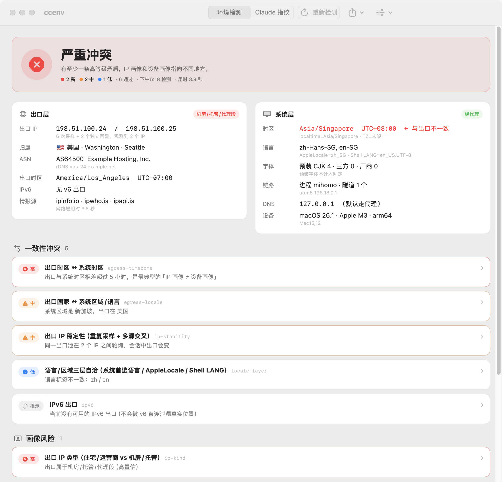
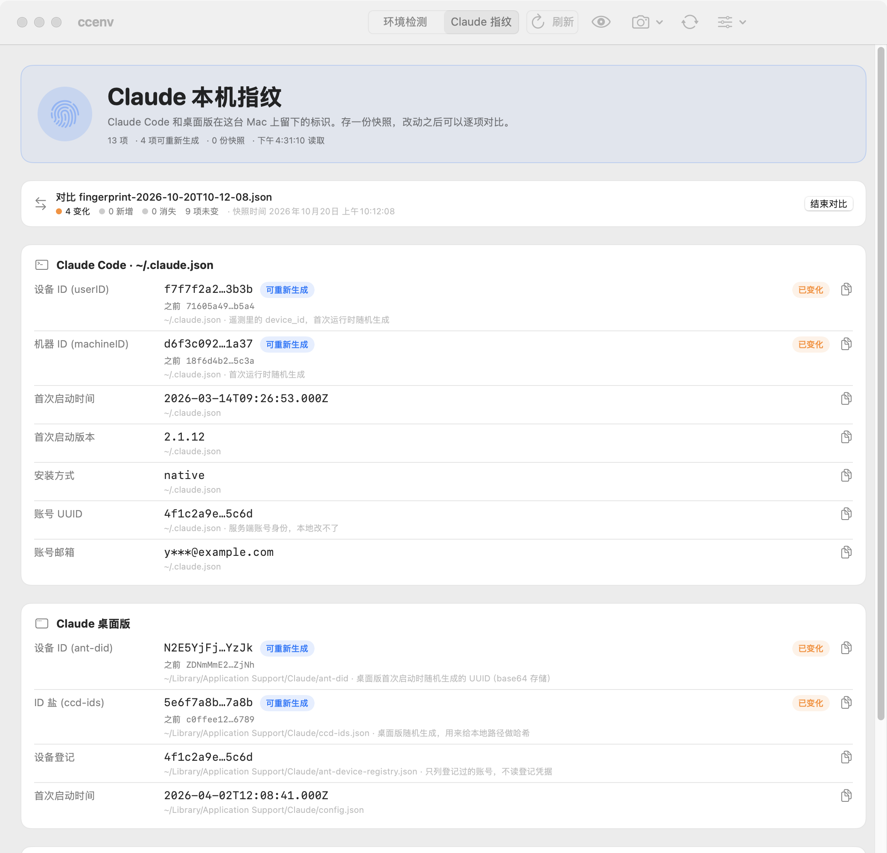

# ccenv

检查这台 Mac 的各层环境画像有没有互相矛盾：网络出口（IP / ASN / GeoIP）、系统时区、语言区域、字体、DNS、时钟、进程架构。输出一份带证据的冲突清单，不打综合分，也不判断环境「像哪个国家」。

比对都在本地完成，检测本身不读取账号信息，网络层只请求几个公开的 IP 回显 / GeoIP 接口。另外可以查看 Claude 在本机留下的标识，存快照、做对比、重新生成随机 ID。



## 安装

到 [Releases](https://github.com/kadaliao/ccenv/releases/latest) 下载 `ccenv-<版本>.dmg`，把 ccenv 拖进「应用程序」。需要 macOS 14 以上；安装包用 Developer ID 签名并经过 Apple 公证，之后会自动更新。

## 环境检测

顶部是结论，中间是出口层和系统层的事实，下面是按等级排好的冲突项，点开能看证据、影响和处理建议。工具栏可以重新检测（⌘R）、复制或导出报告；「分享图片」生成一张只有结论、不含 IP 等细节的卡片。

判定思路：

- 一条规则只对应一个事实，只给离散等级（high / medium / low / info / ok），结论取最高等级，不做加权求和。
- 每台 Mac 都预装的中文字体不计入判定，只看整机厂商的定制字体。
- 公司内网下发的 split DNS、系统自带的 utun 接口，不算泄漏或代理。
- IPv4 和 IPv6 出口分开统计，双栈机器不会被误判成 IP 漂移。

| 规则 | 检查内容 |
| --- | --- |
| egress-timezone | 出口 IP 所在时区和系统时区差几个小时，超过 5 小时为 high |
| egress-locale | 出口国家和系统区域 / 语言对不对得上 |
| ip-stability | 采样期间出口 IP 有没有漂移，跨网段为 high |
| ip-intel-consistency | 几个 GeoIP 源对同一 IP 的国家 / ASN 是否一致 |
| clock-skew | 本机时钟和服务器时间的偏差 |
| tz-layer | TZ 变量、/etc/localtime、系统时区三者是否一致 |
| locale-layer | 系统首选语言、AppleLocale、Shell LANG 三者是否一致 |
| ipv6 | IPv6 和 IPv4 出口是否在同一个国家 |
| dns-path | 默认 DNS 有没有被代理接管 |
| runtime-arch | 进程架构是否和机器一致（Rosetta） |
| ip-kind | 出口属于机房 / 托管段还是运营商段 |
| vendor-fonts | 有没有整机厂商的定制字体 |

## Claude 指纹



列出 Claude Code（`~/.claude.json`）、桌面版（`~/Library/Application Support/Claude/`）和本机硬件里的标识，比如设备 ID、首次启动时间、账号 UUID。只读这些字段，不读令牌、会话和项目数据，默认打码显示。

- **快照与对比**：存一份快照，之后逐项查看哪些变了、新增或消失。
- **重新生成**：把 Claude Code 的 `userID` / `machineID` / `summonSidKey` 和桌面版的 `ant-did` / `salt` 换成新的随机值。动手前自动存快照，并把原文件备份到 `~/.ccenv/backups/`，拷回原处即可恢复。账号 UUID、邮箱、硬件 UUID 和桌面版的设备登记凭据不会改动。

## 命令行

仓库里附带一份零依赖的 Node CLI，规则和应用相同。只从源码运行（Node 20+），不发布到 npm。

```bash
git clone https://github.com/kadaliao/ccenv && cd ccenv
npm link                       # 之后可以直接用 ccenv 命令，也可以 node bin/ccenv.js

ccenv                          # 完整检测
ccenv --explain                # 附带影响说明和处理建议
ccenv --json                   # 结构化输出
ccenv --offline                # 只查本地层
ccenv --exit-code              # 有 high 级冲突时退出码为 1
ccenv fp                       # Claude 指纹，另有 --save / --diff latest / --reset / --reveal
```

`ccenv -h` 查看全部选项。

## 开发

```bash
npm run app                    # 构建 macos/dist/ccenv.app，需要 Xcode 15+
npm test                       # Node 单元测试
cd macos && swift test         # Swift 单元测试
npm run parity                 # 同一台机器上对比 Node 和 Swift 的规则结果
```

`macos/Sources/CCEnvCore` 是 `src/` 的 Swift 移植，文件一一对应，改规则时两边一起改。

## 限制

- `ip-kind` 是启发式判断：免费接口大多不给机房标记，主要靠 ASN 名单和组织名关键字推测。
- 检出矛盾不等于有风险：跨国办公、公司共享出口等都会合理触发时区或区域规则。
- 只在 macOS 上测试过。网络层访问 ipify、Cloudflare trace、ipwho.is、ipinfo.io、ipapi.is；应用检查更新时访问 api.github.com。

## 许可

MIT。起因是想弄清 [yacuo/check-cc](https://github.com/yacuo/check-cc) 的底层逻辑，后来换了判定思路，代码全部重写，不含原项目源码。
